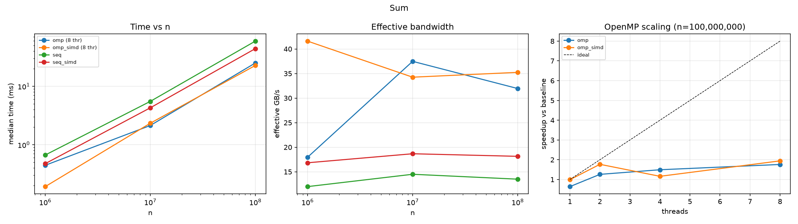

# Parallel Sum Reduction

Sum of `n` double-precision values: sequential, auto-vectorized, OpenMP and OpenMP + SIMD on the CPU.
CUDA versions are the next step (kernel-only and end-to-end results will be added here).

**Headline result:** summing 10^8 doubles is *memory-bound*. One vectorized core reaches about 18 GB/s,
and OpenMP + SIMD saturates the memory system at about 32 GB/s with only 2 threads (about 63% of the
theoretical peak). Eight threads reach about 35 GB/s, so the extra threads add under 10%. The best speedup
over the fair single-threaded baseline (`seq_simd`) is about **1.9x**.

## Implementations

| File | What it is |
|---|---|
| `seq.c` | Strict sequential loop, built `-O3` **without** `-ffast-math`. This is the reference every other version is verified against. |
| `seq_simd.c` | The same source compiled with `-ffast-math -march=native`, so the compiler reassociates and vectorizes the sum. This is the fair single-threaded baseline. |
| `omp.c` | `#pragma omp parallel for reduction(+:sum)` with `schedule(dynamic, 65536)`. <!-- VERIFY: confirm the schedule in omp.c matches the final run --> |
| `omp_simd.c` | OpenMP reduction combined with SIMD, so each thread also vectorizes its chunk. <!-- VERIFY: confirm the pragma, the schedule, and any bench-flags tag (e.g. -march=native) in omp_simd.c --> |

Build flags: `gcc -O3 -std=c11 -Wall -Wextra` (plus `-fopenmp` for the OpenMP files, plus the per-file flags above).

### Why `-ffast-math` matters here

Floating-point addition is not associative. `-ffast-math` (and an OpenMP reduction) lets the sum be
computed in a different order, so the last digits change: at n = 10^8 the strict loop and the fast-math loop
differ around the 11th significant digit (`...960109` vs `...960080`). Both are valid. Because of this,
results are verified with a relative tolerance, not exact equality, and speedups are reported against
`seq_simd`, since comparing OpenMP against the strict loop would credit it for vectorization that has nothing
to do with threads.

## Method

- **Input:** `n` doubles in [0, 1), generated with xorshift64 (seed 42), identical for every implementation.
- **What is timed:** only the sum. Input generation and allocation are excluded.
- **Runs:** per configuration, 1 discarded warm-up process followed by 5 timed processes. The tables report the
  median, and the min is shown because it is less affected by background noise.
- **Threads:** `OMP_NUM_THREADS` is set per run, with `OMP_PROC_BIND=close` and `OMP_PLACES=cores`.
- **Verification:** every timed run must match the reference sum within a relative tolerance of 1e-9.
  All configurations passed.
- **Metrics:** effective bandwidth = `n * 8 bytes / time`, GFLOPS = `n / time` (one add per element), and
  % of peak against the CPU's theoretical memory bandwidth of about 51 GB/s. Speedup is measured against
  `seq_simd` using median times.
- **Harness:** `../../bench.py` builds, runs, verifies and benchmarks every `.c` file in this folder and writes
  `results/*.csv` and a plot. Per-algorithm settings are in `bench.cfg`.

### Hardware and software

| | |
|---|---|
| CPU | 13th Gen Intel Core i5-1334U (12 logical cores; 2 performance + 8 efficiency cores) |
| OS | Ubuntu 24.04 under WSL |
| Compiler | gcc 13.3.0 |
| GPU | none used for the CPU results |

## Reproduce

```bash
cd 01_reduction/Sum
python3 ../../bench.py --plot --threads 1,2,4,8 --baseline seq_simd
```

## Results (n = 100,000,000, i.e. 800 MB)

| Implementation | Threads | Median (ms) | Min (ms) | GB/s | % of peak | Speedup vs `seq_simd` |
|---|---:|---:|---:|---:|---:|---:|
| `seq` (strict) | 1 | 59.26 | 58.77 | 13.5 | 26.4 | 0.74x |
| `seq_simd` | 1 | 44.08 | 38.73 | 18.1 | 35.4 | 1.00x |
| `omp` | 1 | 68.90 | 60.04 | 11.6 | 22.7 | 0.64x |
| `omp` | 2 | 35.00 | 31.95 | 22.9 | 44.6 | 1.26x |
| `omp` | 4 | 29.53 | 23.82 | 27.1 | 52.9 | 1.49x |
| `omp` | 8 | 25.04 | 23.36 | 31.9 | 62.4 | 1.76x |
| `omp_simd` | 1 | 44.53 | 40.65 | 18.0 | 35.1 | 0.99x |
| `omp_simd` | 2 | 24.93 | 23.53 | 32.1 | 62.7 | 1.77x |
| `omp_simd` | 4 † | 37.98 | 24.53 | 21.1 | 41.1 | 1.16x |
| `omp_simd` | 8 | 22.70 | 20.67 | 35.2 | 68.8 | 1.94x |

GB/s, % of peak and speedup are computed from the median time. † This median is an outlier (the run-to-run
variation was 22%). Its min time, 24.5 ms, is about the same as at 2 threads, so the honest reading is that
`omp_simd` is flat after 2 threads.



At n = 10^7 (80 MB) the picture is the same: `omp_simd` at 8 threads is about 1.8x faster than `seq_simd`.
Raw numbers for every size and thread count are in `results/latest.csv`.

## What the results show

1. **The strict loop is limited by add latency, not memory.** `seq` runs at about 0.6 ns per element at every
   size, which is consistent with each add waiting for the previous one. Letting the compiler vectorize
   (`seq_simd`) gives about 1.3x to 1.5x on a single core.
2. **Threads help until memory bandwidth runs out.** Scalar `omp` scales while each thread is latency-bound.
   `omp_simd` has more bandwidth per thread (about 18 GB/s on one core), so it hits the memory ceiling with
   only 2 threads and gains under 10% from going to 8.
3. **Parallel efficiency is the wrong metric here.** Efficiency drops to about 0.24 at 8 threads, but that is a
   consequence of a memory-bound kernel and not a sign of bad parallel code. Bandwidth as a fraction of peak
   is the number that explains the plateau.
4. **Scheduling matters on this hybrid CPU.** With equal static chunks, threads on the slower efficiency cores
   make the faster ones wait. For `omp` at 4 threads, `schedule(dynamic, 65536)` improved the min time from
   about 26 ms to about 23 to 24 ms. Dynamic scheduling also makes the summation order vary between runs,
   which is why the tolerance-based verification is needed. <!-- VERIFY: only keep this item if omp.c is the dynamic version -->
5. **Compared with the strict loop, the best result is about 2.6x to 2.8x** (median and min times at 8 threads).
   Against the fair baseline it is about 1.9x.

## Caveats

- Laptop CPU (15 W class) under WSL, so there is thermal and background noise. Run-to-run variation (cv) is
  often 10% to 50%, which is why 5 reps are not enough to trust every median. Min times are more stable.
- n = 10^6 (8 MB) fits in cache and each run takes under a millisecond, so those rows mostly measure
  process noise and are not used above.
- Runs with 12 threads (all logical cores) were very noisy (cv above 90% in some rows) and are not reported.
- Peak bandwidth is the theoretical value from the memory spec. Sustained bandwidth on this machine is
  lower, so a STREAM measurement would give a more realistic ceiling.

## Next

- CUDA versions of the sum (naive, then shared memory, then warp shuffles), with kernel-only and end-to-end
  timings (including host-to-device transfer) compared against Thrust or CUB.